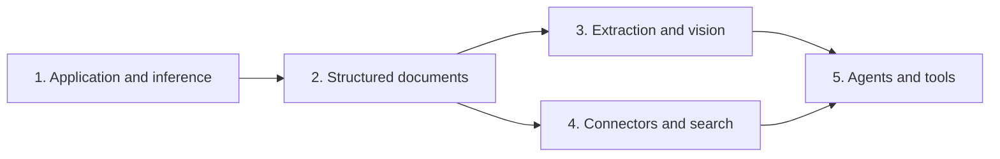

# Roadmap: Enclava company platform

## Overview

Build one Go application around shared identity, durable data and inference execution; then deliver structured documents, standalone processing, connected search and agents. This is application development, not a deployment or hardening program.

Source work-package mapping: B1/B2/B3/C1/C2/C3/F1 → phase 1; E1 → phase 2; E2 → phase 3; D1/D2/D3 → phase 4; F2 is split into real feature screens with the remaining assistant/tool runtime in phase 5. Healthcare-specific source-plan rows are deferred by the user.

## Phases

- [ ] **Phase 1: Application and inference** — PostgreSQL/filesystem foundation, local/OIDC identity, durable work/accounting, routed OpenAI APIs, bounded concurrency and real core screens.
- [ ] **Phase 2: Structured document processing** — isolated native parsing, stable structure/spans, controllable legal/content-aware chunking and previews.
- [ ] **Phase 3: Standalone extraction and vision** — asynchronous durable processing products that need no knowledge index.
- [ ] **Phase 4: Connected knowledge and search** — all five connectors, source grants/provenance, versioned ingestion, hybrid search and trustworthy evidence views.
- [ ] **Phase 5: Agents and approved tools** — durable assistants/conversations, shared built-ins and approved outbound MCP tools.

## Parallel execution

Phase 3 and phase 4 have no dependency on each other. Their leaf packages, fixtures and feature-specific screens can run in separate worktrees after phases 1–2. Serial GSD phase advancement is a safe default; parallel execution requires an integration owner to merge shared composition/manifest/navigation changes serially. This is a file-ownership constraint, not an invented feature dependency. Do not assume an undocumented cross-phase GSD CLI switch.

Within a phase, use the plans' `depends_on` and `wave` fields. Concurrent plans must not write the same file. Raw source adapters and endpoint transports can be developed independently where their named contracts are already established; full integration still needs the actual stores, authorization and executor.

## Phase Details

### Phase 1: Application and inference

**Goal:** A runnable single Go application provides tenant-safe local/OIDC access, durable state/jobs, exact budgets and policy-routed local/confidential OpenAI APIs with bounded resource use and actual administrative screens.
**Depends on:** Nothing
**Requirements:** CORE-01, CORE-02, CORE-03, CORE-04, CORE-05, AUTH-01, AUTH-02, AUTH-03, AUTH-04, AUTH-05, AUTH-06, JOB-01, JOB-02, JOB-03, JOB-04, INF-01, INF-02, INF-03, INF-04, INF-05, INF-06, CON-01, CON-02, UI-01, UI-02
**Success Criteria:**
1. Fresh PostgreSQL plus a durable artifact directory starts the application; no SQLite/import runtime remains and no legacy user data is touched.
2. Local and OIDC users/service keys observe tenant/resource boundaries, explicit linking, revocation and real browser login/key/role flows.
3. Public core and Responses requests traverse the same verified route/policy/accounting path; nested resources and follow-up IDs cannot bypass it.
4. Crash/retry/cancel and two-process load scenarios preserve durable jobs, exact reservations and bounded active/queued work, including streaming disconnects.
5. Endpoint/routing/usage screens display actual state and never expose credentials or simulate unimplemented assurance.

**Plans:** 22/36 plans executed
- [x] 01-01-PLAN.md — PostgreSQL store and isolated fixtures
- [x] 01-02-PLAN.md — Local and verified confidential transports
- [x] 01-03-PLAN.md — PostgreSQL application configuration
- [x] 01-04-PLAN.md — Shared principals and domain contracts
- [x] 01-05-PLAN.md — Identity and source schemas
- [x] 01-06-PLAN.md — Artifacts, jobs, billing and domain schemas
- [x] 01-07-PLAN.md — Durable artifacts and crash reconciliation
- [x] 01-08-PLAN.md — Local accounts, keys, sessions and delegation
- [x] 01-09-PLAN.md — Source repositories and current authorization
- [x] 01-10-PLAN.md — Fenced durable jobs and worker runtime
- [x] 01-11-PLAN.md — Exact multi-unit billing and endpoint records
- [x] 01-12-PLAN.md — OIDC, explicit linking and session endpoints
- [x] 01-13-PLAN.md — Extraction persistence and identity cutover
- [x] 01-14-PLAN.md — Knowledge/connector persistence and identity cutover
- [x] 01-15-PLAN.md — Prompt/assistant persistence and identity cutover
- [x] 01-16-PLAN.md — HTTP identity boundary and callers
- [x] 01-17-PLAN.md — Budget/pricing administration and accounting reads
- [x] 01-18-PLAN.md — Endpoint administration and stored provider records
- [x] 01-19-PLAN.md — Extraction HTTP/dashboard boundary
- [x] 01-20-PLAN.md — Session-authenticated dashboard
- [x] 01-21-PLAN.md — Bound credential references
- [x] 01-22-PLAN.md — Fresh bootstrap and core composition
- [ ] 01-23-PLAN.md — Shared inference policy and execution
- [ ] 01-24-PLAN.md — User, role and service-key administration
- [ ] 01-25-PLAN.md — Extraction through the shared executor
- [ ] 01-26-PLAN.md — Identity and access screens
- [ ] 01-27-PLAN.md — Index/query embeddings through the shared executor
- [ ] 01-28-PLAN.md — Assistant calls through the shared executor
- [ ] 01-29-PLAN.md — Explicit public OpenAI core API
- [ ] 01-30-PLAN.md — Owned Responses API
- [ ] 01-31-PLAN.md — Bounded concurrency and two-process accounting
- [ ] 01-32-PLAN.md — Route, endpoint and policy screens
- [ ] 01-33-PLAN.md — Usage, exact pricing and budget screens
- [ ] 01-34-PLAN.md — Retire generic passthrough
- [ ] 01-35-PLAN.md — Retire legacy principal/accounting paths
- [ ] 01-36-PLAN.md — Finish single-store composition and prove the core

### Phase 2: Structured document processing

**Goal:** Real documents become immutable ordered evidence blocks and controlled chunks, with native processor isolation and a preview identical to downstream processing.
**Depends on:** Phase 1
**Requirements:** DOC-01, DOC-02, DOC-03, DOC-04, DOC-05, DOC-06
**Success Criteria:**
1. Actual PDF/OCR/DOCX and text/structured fixtures produce truthful locations, errors and bounded resource behavior; fake PDF extraction is gone.
2. Legal/document/chat/code profiles expose versioned controls and preserve known clause/thread/table/exception boundaries.
3. Native children cannot read unrelated artifacts/secrets or use the network; cancellation stops their process trees.
4. Browser previews show actual chunk text, provenance and warnings; local JSON Schema validation preserves numeric values and refuses external references.

**Plans:** 5 plans
- [ ] 02-01-PLAN.md — Parse real documents into ordered evidence blocks
- [ ] 02-02-PLAN.md — Version structural chunk profiles and preserve legal boundaries
- [ ] 02-03-PLAN.md — Validate structured output with a complete local schema implementation
- [ ] 02-04-PLAN.md — Expose durable document previews and retire duplicate parser paths
- [ ] 02-05-PLAN.md — Make document structure and chunk controls reviewable in the browser

### Phase 3: Standalone extraction and vision

**Goal:** A company can submit a narrow extraction or image-recognition task and retrieve an authorized durable result without deploying search or connectors.
**Depends on:** Phase 1, Phase 2
**Requirements:** PROC-01, PROC-02, PROC-03, PROC-04, PROC-05
**Success Criteria:**
1. Input persistence precedes job-ID acknowledgement; status/result/cancel/delete survive application and worker restart.
2. Real model calls route through shared policy/accounting and output is locally validated, versioned and identified as generated.
3. Actual embedded screens work with Qdrant unavailable and show real progress, evidence, failures and usage.
4. Deletion/retention fences stale work and affects only authorized artifacts; nothing is automatically published into knowledge.

**Plans:** 3 plans
- [ ] 03-01-PLAN.md — Run durable asynchronous extraction and image-recognition jobs
- [ ] 03-02-PLAN.md — Authorize processing results, cancellation, deletion and retention
- [ ] 03-03-PLAN.md — Deliver standalone processing screens and the current API reference

### Phase 4: Connected knowledge and search

**Goal:** Slack, Teams, GitHub, Notion and Google Drive feed a permission-aware, source-linked hybrid search product with controlled structured ingestion.
**Depends on:** Phase 1, Phase 2 (not Phase 3)
**Requirements:** SRC-01, SRC-02, SRC-03, SRC-04, SRC-05, SRC-06, SRC-07, IDX-01, IDX-02, IDX-03, SEARCH-01, SEARCH-02, SEARCH-03, SEARCH-04, SEARCH-05, SEARCH-06
**Success Criteria:**
1. Every named source has a real bounded adapter, meaningful native/retained locations, durable progress and explicitly exercised access semantics; Notion uses selected published audiences.
2. Failed replacement never destroys a still-authorized published version; recorded revocation/deletion immediately blocks affected reads and stale workers cannot republish it.
3. A real Qdrant corpus proves native lexical/dense fusion, lexical-only availability, current access enforcement and useful structure-aware context.
4. Evidence IDs resolve to current authorized versions/locations; forged or revoked references reveal neither content nor metadata.
5. Source/search screens support actual configuration, sync, search, preview and evidence navigation; explicitly imported generated results retain their identity/restrictions.

**Plans:** 10 plans
- [ ] 04-01-PLAN.md — Durable source streams and observation persistence
- [ ] 04-02-PLAN.md — GitHub content and native permissions
- [ ] 04-03-PLAN.md — Slack threads, reconciliation and permissions
- [ ] 04-04-PLAN.md — Teams channel and chat content/permissions
- [ ] 04-05-PLAN.md — Notion published-audience sources
- [ ] 04-06-PLAN.md — Google Drive structured files and native restrictions
- [ ] 04-07-PLAN.md — Versioned ingestion, publication and explicit result import
- [ ] 04-08-PLAN.md — Hybrid retrieval, authorized context and evidence
- [ ] 04-09-PLAN.md — Source configuration, search and evidence screens
- [ ] 04-10-PLAN.md — Actual knowledge composition and live corpus/browser proof

### Phase 5: Agents and approved tools

**Goal:** Employees and service identities use durable assistants with company knowledge, processing jobs and approved MCP tools without a second authorization/execution path.
**Depends on:** Phase 1, Phase 3, Phase 4
**Requirements:** AGENT-01, AGENT-02, AGENT-03, AGENT-04, AGENT-05
**Success Criteria:**
1. Assistant configuration, conversation replay and each tool/model invocation intersect caller authority with input/source restrictions.
2. Knowledge tools use the same authorized retrieval; extraction returns real asynchronous job references and progress.
3. Approved MCP tool calls preserve origin binding, bounded execution and schema approval; unknown side effects are not replayed.
4. Revoked source text is removed from reusable conversation context, not merely hidden behind a removed citation.
5. Actual browser/API runs exercise the completed company and standalone product paths, including cancellation, denial and source-linked results.

**Plans:** 4 plans
- [ ] 05-01-PLAN.md — Persist authorized assistants, conversations and bounded built-in runs
- [ ] 05-02-PLAN.md — Call explicitly approved outbound MCP tools
- [ ] 05-03-PLAN.md — Compose agent runs, approved tools and their public lifecycle
- [ ] 05-04-PLAN.md — Deliver the assistant UI and exercise the completed company product

## Progress

| Phase | Status | Completed plans |
|---|---|---|
| 1. Application and inference | Ready to execute | 0/36 |
| 2. Structured document processing | Planned; needs phase 1 | 0/5 |
| 3. Standalone extraction and vision | Planned; needs phases 1–2 | 0/3 |
| 4. Connected knowledge and search | Planned; needs phases 1–2 | 0/10 |
| 5. Agents and approved tools | Planned; needs phases 3–4 | 0/4 |

58 executable plans cover all 57 requirement IDs. Native structure validation and both semantic review tracks passed with zero remaining blockers or warnings. Dependency/wave, within-phase file-ownership and native execution-consumer checks passed. No application behavior is marked complete by this planning import.
